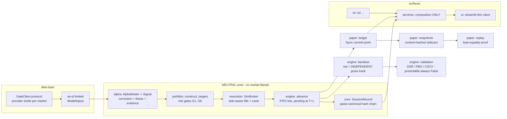

# Architecture (NEW, P10-S5)

## The one-picture version

## The invariants (each enforced by a named test)

| Invariant | Where | Enforced by |
|---|---|---|
| Neutral zones carry no market literals | core/ engine/ alpha/ ... | G10 literal guard + fail-proofs |
| Money is integer paise at the ledger boundary | core/money.py | test_money.py |
| Records are hash-chained, canonical-paise | core/session.py | tamper tests |
| The ledger is truth; cache is derivable | paper/fund.py | cache-mismatch halts |
| Pending decision survives the tick boundary | paper/fund.py | live-model equality test |
| Decisions at T, execution at T+1 | engine/advance.py | test_decide_at_t_executes_at_t_plus_1 |
| Replay equals the ledger, byte for byte | paper/replay.py | TestReplayByteEquality + mutation check |
| The LLM never touches the trading path | llm/ (import boundary) | TestSeparationR1 |
| LLM text is UNTRUSTED display-only | llm/types.py | flag pinned True |
| promotable is always False on this data | engine/validation.py | toy-vs-control spec tests |

## Package map

| Package | Role | May import |
|---|---|---|
| core/ | frozen domain models, money, market rules | stdlib, pydantic |
| markets/ | per-market profiles, providers, FX stub | core |
| marketdata/ | provider chain, as-of limiting, quality | core |
| alpha/ | quant models (live + stub) | core (+currency table) |
| portfolio/ | construction, risk gates, tax | core |
| execution/ | SimBroker, PaperBroker, costs | core |
| engine/ | advance, backtest, calendar, metrics, validation, reports | all neutral |
| paper/ | ledger, fund lifecycle, kill switch, events, sidecars | neutral |
| llm/ | LLM types, safety, validation, runtime | core + stdlib + pydantic ONLY |
| services/ | UI-facing composition (formatting, vocabulary) | core, paper, markets, engine, alpha, marketdata |
| ui/ | Streamlit thin client | services, streamlit, plotly, stdlib |
| cli/ | the nd command surface | everything (composition point) |

Full layering rules with fail-proofs: tests/test_alpha.py
(TestImportBoundary), tests/test_services.py, tests/test_ui.py,
tests/test_llm.py (TestImportBoundary).
